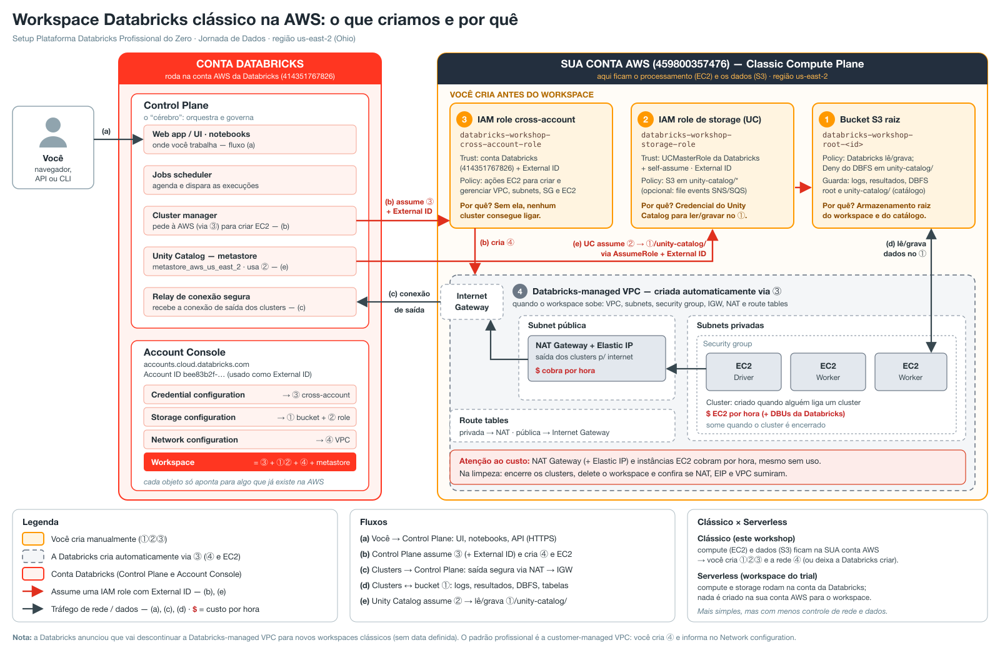

# Setup Plataforma Databricks Profissional do Zero (AWS)

Workshop ao vivo da Jornada de Dados · **Do Zero à Produção — Databricks Enterprise na AWS** · sábado, 07/11/2026, 9h às 13h.

O repositório tem tudo para montar, do zero, uma plataforma Databricks com cara de empresa na AWS (região **Ohio, `us-east-2`**): workspace clássico, ambientes DEV e PROD, governança com Unity Catalog, pipeline Bronze → Silver → Gold, promoção com Asset Bundles e consumo por Dashboard, App e Genie.



## Por onde começar

| Quero… | Vá para |
|---|---|
| Entender os conceitos (10 min) | [`manual/fundamentos.md`](manual/fundamentos.md) |
| Criar o workspace **à mão**, com prints | [`manual/README.md`](manual/README.md) + [policies prontas para colar](manual/policies/prontas/928844615034/COLAR.md) |
| Criar os workspaces **por código** | [`terraform/README.md`](terraform/README.md) |
| Montar o projeto completo (governança, pipeline, consumo) | [`food-intelligence-platform/README.md`](food-intelligence-platform/README.md) |
| Dar a aula | [roteiro do instrutor](food-intelligence-platform/docs/workshop-guide.md) · [roteiro de fala slide a slide](food-intelligence-platform/docs/roteiro-slides.md) · [apresentação](https://claude.ai/artifact/UFhcfvGJBqyJgqYZmvxuFj) |
| Montar numa **conta nova** sem repetir os erros do ensaio | [`food-intelligence-platform/docs/troubleshooting.md`](food-intelligence-platform/docs/troubleshooting.md) |

## Estrutura

```text
.
├── manual/                        # passo a passo no console, com prints
│   ├── README.md                  #   seções 0 a 8 + Troubleshooting (SCP/RCP)
│   ├── fundamentos.md · arquitetura/
│   ├── prints-v2/ · prints/       #   prints dos ensaios
│   └── policies/                  #   policies IAM/S3 (modelos com < >)
│       ├── gerar_policies.py      #   gera as policies JÁ PREENCHIDAS
│       └── prontas/<conta>/COLAR.md
├── terraform/                     # stack de infraestrutura: bucket raiz, roles, workspaces
├── food-intelligence-platform/    # o projeto do workshop (ver README próprio)
│   ├── infrastructure/terraform/  #   stack de governança: buckets raw/lakehouse, UC, grupos
│   ├── databricks.yml · resources/ · notebooks/ · src/ · app/ · dashboards/ · genie/
│   ├── data/ · tests/ · scripts/
│   └── docs/                      #   arquitetura, ambientes, governança, roteiros, lições
├── .llm/prd.md                    # PRD do workshop
└── .claude/skills/                # skills oficiais da Databricks para o Claude Code
```

## Scripts e comandos

Ordem de uso, do zero até a aula. Cada comando tem detalhes no README da pasta.

| # | Para quê | Comando |
|---|---|---|
| 0 | Logins (conta Databricks e AWS) | `databricks auth login --host https://accounts.cloud.databricks.com --account-id <ID> --profile workshop-account` · `aws login --profile <profile> --region us-east-2` ([manual 0.1](manual/README.md#01-login-pelo-terminal-cli)) |
| 1 | Policies preenchidas para o setup **manual** | `python3 manual/policies/gerar_policies.py --aws <AWS_ID> --databricks <DBX_ID> --prefix workshop` → `manual/policies/prontas/<AWS_ID>/COLAR.md` |
| 2 | Workspaces DEV e PROD **por código** | `cd terraform && terraform init && terraform plan && terraform apply` |
| 3 | Login em cada workspace | `databricks auth login --host <url> --profile food-dev` (e `food-prod`) |
| 4 | Governança (buckets, UC, grupos, permissões) | `cd food-intelligence-platform/infrastructure/terraform && terraform apply` |
| 5 | Gerar e enviar os dados ao bucket raw | `python3 food-intelligence-platform/data/generate_orders.py` · `./food-intelligence-platform/data/upload_to_s3.sh dev <profile>` (e `prod`) |
| 6 | Testes locais (estágio TEST) | `cd food-intelligence-platform && uv run --no-project --with pytest pytest tests -q` |
| 7 | Publicar e rodar em DEV | `databricks bundle deploy -t dev && databricks bundle run food_orders_pipeline -t dev` |
| 8 | Promover para PROD | `databricks bundle deploy -t prod && databricks bundle run food_orders_pipeline -t prod && databricks bundle deploy -t prod && databricks bundle run food_explorer -t prod` |
| 9 | Teste de ponta a ponta (DEV e PROD) | `python3 food-intelligence-platform/scripts/smoke_test.py` → "TUDO OK" |
| 10 | Regerar dashboard / Genie depois de editar | `python3 food-intelligence-platform/dashboards/build_dashboard.py` · `python3 food-intelligence-platform/genie/build_genie_space.py` |
| 11 | Limpeza no mesmo dia | [`docs/workspaces.md#limpeza`](food-intelligence-platform/docs/workspaces.md#limpeza) |

## Estado do ensaio (06/11/2026)

| Item | Situação |
|---|---|
| Contas | AWS `928844615034` (us-east-2) · Databricks `bee83b2f-…` |
| Workspaces | FOOD-DEV e FOOD-PROD `RUNNING` (HML opcional) |
| Governança | 55 recursos: buckets raw/lakehouse, 5 grupos, usuários de teste, `food_dev` e `food_prod` isolados |
| Pipeline | DEV e PROD com SUCCESS (bronze 20.400 · silver 20.000 · gold 5.108) |
| Consumo | Dashboard, Genie e Data App publicados nos dois ambientes, via `Food Classic Warehouse` |
| Teste | `smoke_test.py`: 20/20 OK (o aviso do SQL serverless é esperado nesta conta) |
| Planos B (não apagar) | `workspace` (serverless, para o Express) e `workshop-aws` (clássico) |

## Atenção ao custo

Cada workspace clássico custa ≈ **US$ 1,20/dia parado** (NAT Gateway + IP público). EC2 e DBUs cobram só no uso; o `Food Classic Warehouse` desliga sozinho após 10 min parado.

**Terminou o workshop? Faça a [limpeza](food-intelligence-platform/docs/workspaces.md#limpeza) no mesmo dia.**
