# Manual · Setup Plataforma Databricks Profissional do Zero (AWS)

Workshop ao vivo da Jornada de Dados · sábado, 07/11/2026, 9h às 13h.

Este manual acompanha a **Etapa 2 (preparar a AWS)** e a **Etapa 3 (configurar o Databricks como profissional)** do workshop. Cada passo tem um print da tela e a explicação do que está sendo criado e por quê.

> Os prints foram tirados num ensaio real, em 06/11/2026, na conta AWS `928844615034` (pasta `prints-v2/`; os prints do passo 1, da criação do bucket e do passo 4.5 são de um ensaio anterior, pasta `prints/`). As telas da AWS e da Databricks mudam com frequência; se algum botão estiver em outro lugar, procure pelo mesmo nome.

---

## 0. Antes de começar

**Você vai precisar de:**

- Uma conta AWS **no plano pago** (cartão cadastrado), em que você possa criar IAM roles e buckets S3. O *Free plan* das contas AWS novas limita serviços e créditos, e o workspace clássico cria recursos cobrados por hora (NAT Gateway, EC2). Veja [Quanto custa](#quanto-custa).
- Se a sua conta AWS faz parte de uma **AWS Organization** (por exemplo, criada pela tela **"Projects"** da AWS), ela pode ter **SCPs e RCPs** que bloqueiam a Databricks. Leia o [Troubleshooting](#troubleshooting) **antes** de começar.
- Uma conta Databricks (trial de 14 dias serve) com acesso ao **Account Console**: <https://accounts.cloud.databricks.com>.
- O **Databricks Account ID** (canto superior direito do Account Console, no menu do usuário) e o **AWS Account ID** (canto superior direito do console da AWS).
- A mesma **região** para tudo. Neste manual: **Ohio (`us-east-2`)**.

**Anote estes valores, você vai usar várias vezes:**

| Valor | Exemplo do ensaio | Onde achar |
|---|---|---|
| `DATABRICKS_ACCOUNT_ID` | `bee83b2f-4880-413a-9b08-badf19a3d7a2` | Account Console, menu do usuário |
| `AWS_ACCOUNT_ID` | `928844615034` | Console AWS, canto superior direito |
| `NOME_DO_BUCKET` | `databricks-workshop-root-928844615034` | você escolhe (passo 2) |
| `NOME_DA_STORAGE_ROLE` | `databricks-workshop-storage-role` | você escolhe (passo 4) |
| Nome da cross-account role | `databricks-workshop-cross-account-role` | você escolhe (passo 5) |

As policies em JSON estão na pasta [`policies/`](policies/), com os textos entre `< >` para trocar pelos seus valores.

**Atalho: policies já preenchidas, prontas para copiar e colar.** Rode, com os seus valores:

```bash
python3 manual/policies/gerar_policies.py --aws <AWS_ACCOUNT_ID> --databricks <DATABRICKS_ACCOUNT_ID> --prefix workshop
```

Ele cria `manual/policies/prontas/<AWS_ACCOUNT_ID>/COLAR.md`: cada policy na ordem do manual, com o lugar exato do console onde colar, os nomes das roles e o JSON pronto. As da conta do ensaio estão em [`policies/prontas/928844615034/COLAR.md`](policies/prontas/928844615034/COLAR.md).

> Vai montar numa conta nova? Leia antes o checklist de lições do ensaio: [`food-intelligence-platform/docs/troubleshooting.md`](../food-intelligence-platform/docs/troubleshooting.md) (Organization com SCP/RCP, limite diário de workspaces, catálogo automático, SQL serverless).

### 0.1 Login pelo terminal (CLI)

Só é necessário se você for automatizar (Terraform, scripts, criar os workspaces DEV/HML/PROD por código). Pelo console, basta o navegador.

Existem **dois tipos de login** na Databricks, e eles não se substituem:

| Login | Host | Serve para |
|---|---|---|
| **Conta** (account) | `https://accounts.cloud.databricks.com` | Criar workspaces, credenciais, storage, grupos e usuários, e atribuir quem acessa qual workspace |
| **Workspace** | `https://dbc-xxxx.cloud.databricks.com` | Trabalhar *dentro* de um workspace que já existe: catálogos, notebooks, jobs, clusters |

**Uma conta, vários workspaces.** A conta Databricks é o "guarda-chuva": ela pode ter vários workspaces (aqui, FOOD-DEV e FOOD-PROD). O seu **usuário** também é um só, cadastrado na conta, e pode ser atribuído a quantos workspaces o admin quiser. É assim que alguém tem acesso a DEV e não a PROD: o mesmo usuário, atribuído só ao workspace de DEV.

No CLI a lógica é a mesma:

- O **profile de conta** (`workshop-account`) enxerga e administra **todos** os workspaces da conta.
- Cada **profile de workspace** aponta para **um** workspace só. Para trabalhar nos dois, você cria dois profiles (`food-dev` e `food-prod`), os dois com o mesmo usuário (passo 5 abaixo).

Um workspace não cria outro workspace. Por isso, para criar FOOD-DEV e FOOD-PROD, você precisa do **login de conta**, e o seu usuário precisa ser **account admin**.

**1. Instalar o Databricks CLI** (versão nova, `>= 0.200`; o pacote antigo do `pip` não serve):

```bash
brew tap databricks/tap && brew install databricks   # macOS
databricks version
```

No Windows/Linux, siga <https://docs.databricks.com/aws/en/dev-tools/cli/install>.

**Asset Bundles (DABs) já vêm no CLI.** Não há nada separado para instalar: os bundles são o comando `databricks bundle`, que vamos usar para promover código de DEV para PROD. Para conferir:

```bash
databricks bundle --help
```

**(Opcional) Skills da Databricks para o agente de IA.** Se você usa Claude Code, Cursor, Codex ou outro agente de código, o próprio CLI instala as skills oficiais da Databricks (fonte: <https://github.com/databricks/databricks-agent-skills>). Elas ensinam o agente a usar bundles, jobs, Unity Catalog etc. do jeito certo. Rode na pasta do projeto:

```bash
databricks aitools install --agents claude-code --scope project --skills-only
databricks aitools list        # confere o que foi instalado
```

- `--scope project` grava as skills dentro do projeto (`.claude/skills/`), então elas vão junto com o repositório. Sem essa opção, a instalação é global (vale para todos os projetos).
- `--agents` escolhe o agente: `claude-code`, `cursor`, `codex` etc. Sem a opção, o CLI pergunta.
- Para atualizar depois: `databricks aitools update`.

**2. Login na conta Databricks:**

```bash
databricks auth login \
  --host https://accounts.cloud.databricks.com \
  --account-id <DATABRICKS_ACCOUNT_ID> \
  --profile workshop-account
```

O navegador abre, você entra com o usuário admin da conta e autoriza. O CLI grava um profile chamado `workshop-account` em `~/.databrickscfg`, sem senha nem token em texto: o login é OAuth e o token se renova sozinho.

**3. Conferir se funcionou:**

```bash
databricks auth profiles                                  # workshop-account deve aparecer com Valid = YES
databricks account workspaces list --profile workshop-account
```

Se o segundo comando listar os workspaces da conta (ou devolver `[]` numa conta nova), o login está ok.

**4. Login na AWS** (o Terraform também cria bucket e IAM roles):

```bash
aws sso login --profile <SEU_PROFILE_AWS>        # ou: aws configure --profile <SEU_PROFILE_AWS>
aws sts get-caller-identity --profile <SEU_PROFILE_AWS>
```

O `Account` retornado deve ser o seu `AWS_ACCOUNT_ID`.

**5. (Depois que os workspaces existirem) login em cada workspace:**

```bash
databricks auth login --host https://<deployment-do-FOOD-DEV>.cloud.databricks.com  --profile food-dev
databricks auth login --host https://<deployment-do-FOOD-PROD>.cloud.databricks.com --profile food-prod
```

A URL de cada workspace aparece no Account Console → **Workspaces**, ou no campo `deployment_name` do comando `databricks account workspaces list`.

> **Erros comuns:** `cannot configure default credentials` significa que faltou o `--profile` no comando. `PERMISSION_DENIED` no login de conta significa que o seu usuário não é account admin. Se o token expirar, rode o mesmo `databricks auth login` de novo.

---

## Arquitetura: o que vamos criar e por quê

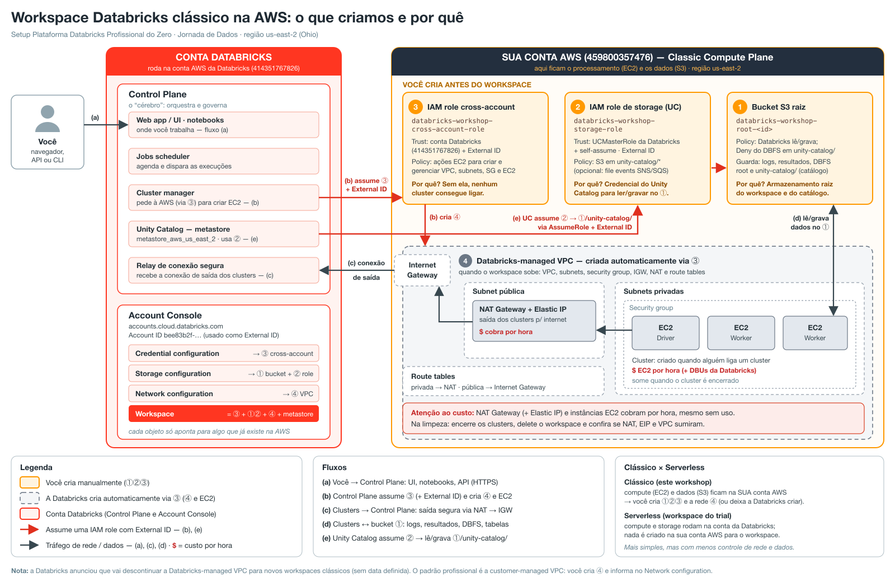

O workspace clássico tem duas metades:

- **Control Plane**, na conta da Databricks: a interface, os notebooks, o agendador de jobs, o gerenciador de clusters e o Unity Catalog.
- **Compute Plane**, na **sua** conta AWS: as máquinas (EC2) e os dados (S3).

Para a Databricks operar a sua metade, você entrega duas "chaves" (IAM roles) e um bucket. A explicação completa, com a tabela de custos de cada recurso, está em [`arquitetura/README.md`](arquitetura/README.md).

---

## 1. Entendendo a tela "Create workspace"

Antes de criar qualquer coisa na AWS, vale entender o que a Databricks pede. Tudo o que fazemos na AWS existe para preencher esta tela.

### 1.1 Dois tipos de workspace

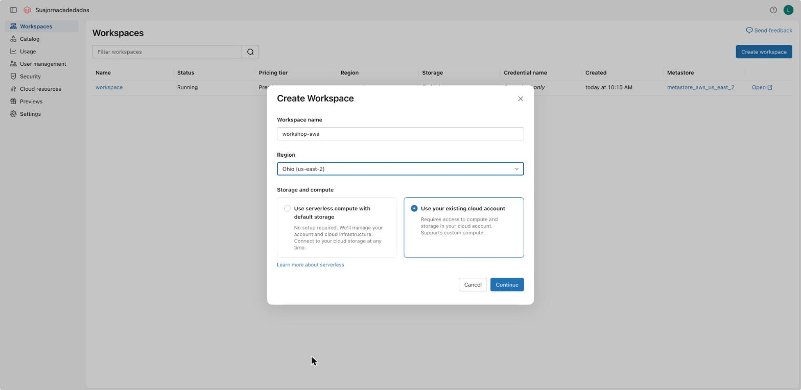

Quando você cria a conta (trial), a Databricks já cria um workspace chamado `workspace`. Ele é **serverless**: o compute e o storage rodam na conta da própria Databricks, e você não configura nada na AWS.

No workshop vamos criar o outro tipo, o **clássico**, escolhendo **"Use your existing cloud account"**. É o que as empresas usam quando querem:

- os dados no **próprio bucket S3**, dentro da conta AWS da empresa;
- os clusters rodando na **própria VPC**, com controle de rede, segurança e custo;
- clusters clássicos (EC2), GPUs e instâncias específicas.

| | Serverless (default storage) | Clássico (sua conta AWS) |
|---|---|---|
| Onde roda o compute | Conta da Databricks | Sua conta AWS (EC2) |
| Onde ficam os dados | Storage gerenciado pela Databricks | Seu bucket S3 |
| Configuração na AWS | Nenhuma | IAM, S3 e rede |
| Quando usar | Testes rápidos, times pequenos | Empresas, governança, compliance |

### 1.2 Os blocos do formulário

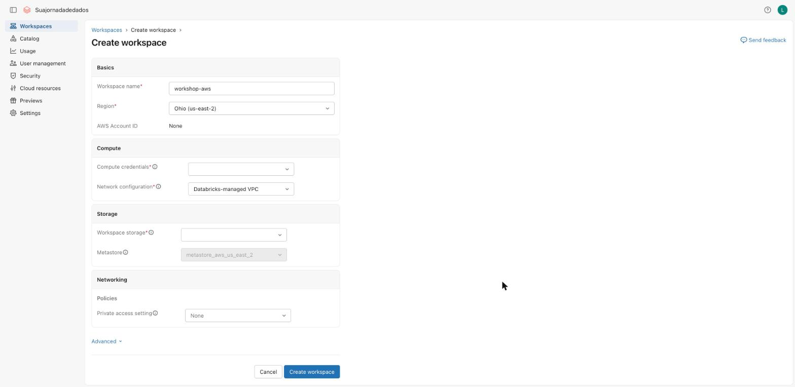

| Bloco | Campo | O que é |
|---|---|---|
| **Basics** | Workspace name, Region | Nome do workspace (vira parte da URL) e região da AWS onde ele vai rodar. Bucket e workspace precisam estar na **mesma região**. |
| **Compute** | Compute credentials | Uma **IAM role cross-account** na sua AWS que a Databricks pode "assumir" para **ligar e desligar máquinas EC2** (os clusters). É a chave que você entrega para a Databricks operar o compute. |
| **Compute** | Network configuration | **Em qual rede (VPC)** os clusters vão rodar. *Databricks-managed VPC*: a Databricks cria a VPC para você. *Customer-managed VPC*: você cria e controla a rede. |
| **Storage** | Workspace storage | O **bucket S3 raiz** do workspace (logs, resultados de notebooks, arquivos do sistema e o catálogo do workspace) mais a **IAM role de storage** que o Unity Catalog usa para ler e gravar nesse bucket. |
| **Storage** | Metastore | O **metastore do Unity Catalog** da região: o "catálogo central" de governança (tabelas, permissões, linhagem). Já existe um por região e é atribuído automaticamente. |
| **Networking** | Private access setting | **PrivateLink**: acesso ao workspace sem passar pela internet pública. Opcional e mais avançado; usamos *None* no workshop. |

> **Resumo para a aula:** o workspace clássico precisa de **3 coisas suas** na AWS: uma **role para compute**, um **bucket com uma role para storage** e uma **rede**. Os passos a seguir criam cada uma delas.

### 1.3 Automático ou manual?

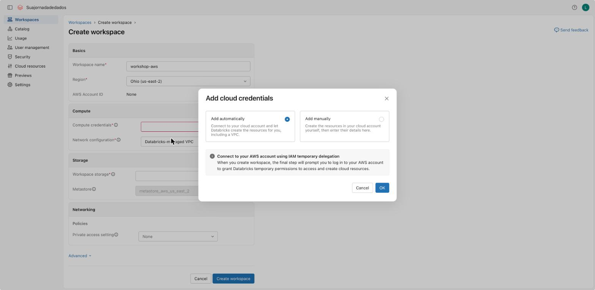

Para credencial e storage, a Databricks oferece dois caminhos:

- **Automático (IAM temporary delegation):** você faz login na AWS, e a Databricks cria as roles, o bucket e a VPC por você. É rápido, mas você não vê o que foi criado.
- **Manual:** você cria cada recurso na AWS e cola os identificadores aqui. **É o caminho do workshop**, porque é assim que você aprende o que cada peça faz e consegue explicar e auditar o ambiente numa empresa.

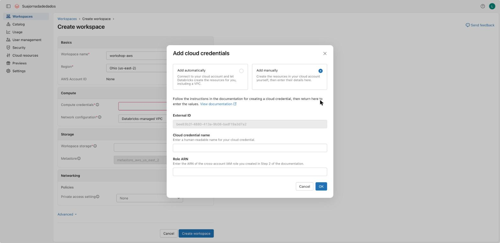

Na credencial manual aparecem dois campos importantes:

- **External ID:** é o seu **Databricks Account ID**. Ele entra na trust policy da role como uma "senha" extra, garantindo que só a **sua** conta Databricks consiga assumir a role, e não qualquer cliente da Databricks.
- **Role ARN:** o identificador da cross-account role que vamos criar no passo 5.

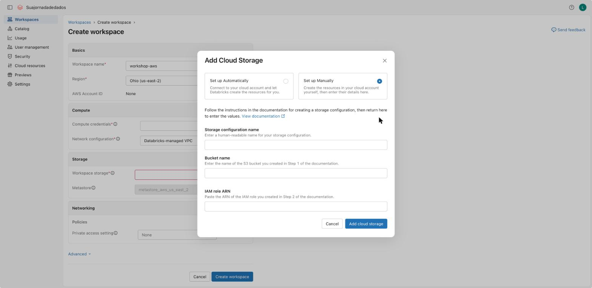

No storage manual, a Databricks pede o **nome do bucket** (passo 2) e o **ARN da IAM role de storage** (passo 4).

### 1.4 Antes de decidir: três regras

- **Workspace clássico = credential + storage + network (opcional).** São objetos registrados na conta Databricks que só apontam para o que você criou na AWS.
- **Região e modelo de rede não mudam depois.** Não dá para converter Databricks-managed VPC em customer-managed. Em produção, na dúvida, use customer-managed.
- **Serverless é o padrão desde 2026.** Clássico é escolha consciente: VPC própria, instância específica ou feature que falta na região.

> Control plane, tiers, serverless × clássico e as escolhas sem volta, explicados em 10 minutos: [`fundamentos.md`](fundamentos.md).

---

## 2. AWS · Criar o bucket S3 raiz

**O que é:** o bucket raiz (*root bucket*) é onde o workspace guarda os próprios arquivos: logs, resultados de notebooks, bibliotecas e, sob o prefixo `unity-catalog/`, os dados do **catálogo do workspace**.

**Onde:** Console AWS → **S3** → **Create bucket**.

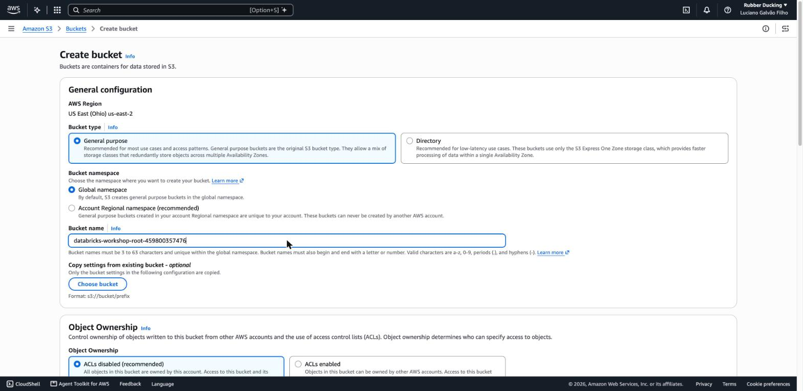

1. Confira se a região no topo é **US East (Ohio) us-east-2**.
2. **Bucket type:** *General purpose*.
3. **Bucket name:** um nome único no mundo inteiro. Dica: termine com o seu AWS Account ID, por exemplo `databricks-workshop-root-<AWS_ACCOUNT_ID>`.

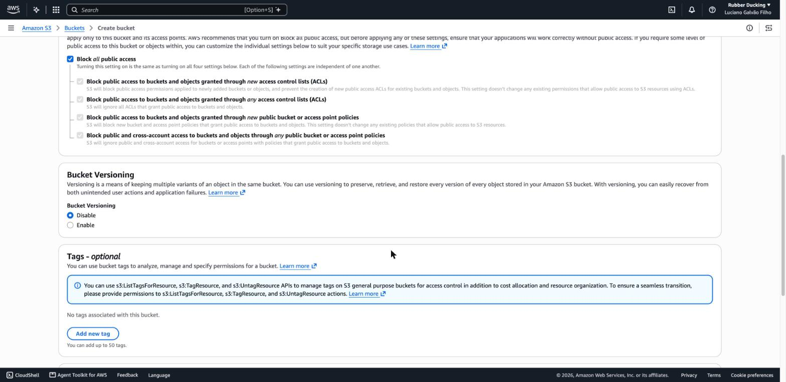

4. **Object Ownership:** *ACLs disabled* (recomendado).
5. **Block all public access:** deixe **marcado**. A Databricks acessa o bucket por IAM, nunca por acesso público.
6. **Bucket Versioning:** *Disable* (no workshop; em produção avalie ativar).

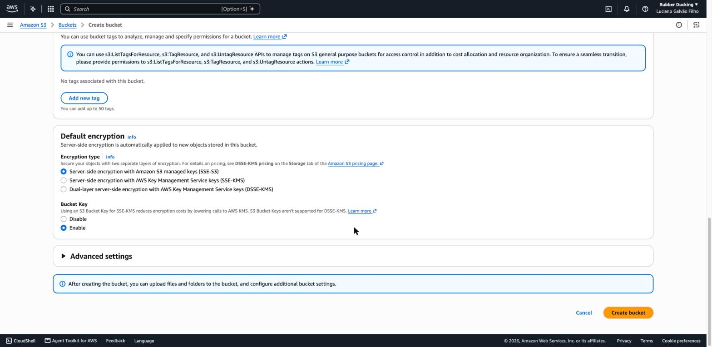

7. **Default encryption:** *SSE-S3* (padrão). Clique em **Create bucket**.

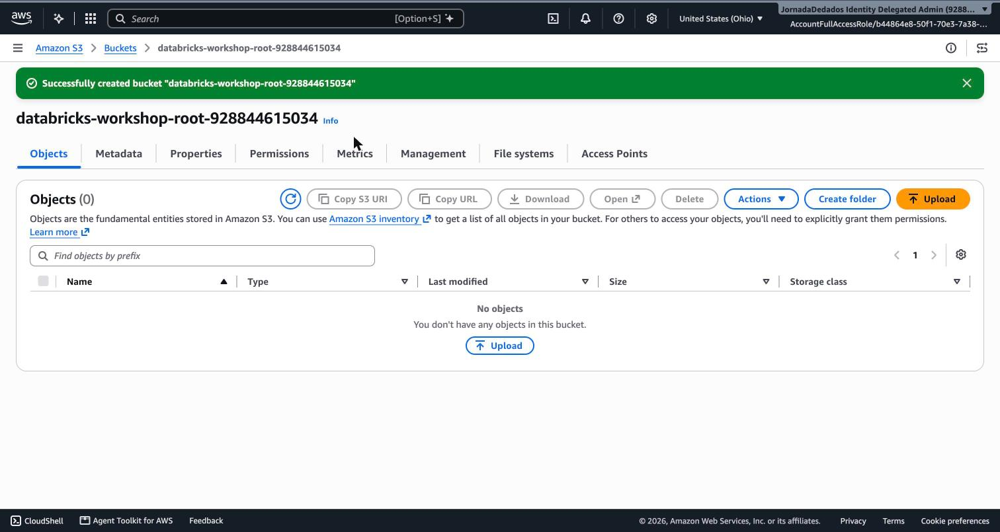

**Custo:** um bucket vazio não custa nada. Você paga pelo que for gravado nele.

---

## 3. AWS · Bucket policy: deixar a Databricks usar o bucket

**O que é:** a *bucket policy* é a regra escrita no próprio bucket dizendo **quem de fora** pode acessá-lo. Sem ela, a conta da Databricks não consegue gravar os arquivos do workspace.

**O que a nossa policy diz** ([`policies/03-bucket-policy.json`](policies/03-bucket-policy.json)):

1. **Allow:** a conta AWS da Databricks (`414351767826`) pode ler, gravar e listar o bucket, **mas só** quando a chamada vier marcada com o **seu** Databricks Account ID (`aws:PrincipalTag/DatabricksAccountId`). Outros clientes da Databricks não entram.
2. **Deny:** a mesma conta **não** pode acessar o prefixo `unity-catalog/`. Essa pasta é do Unity Catalog, que acessa com a role própria (passo 4). Assim os dados governados não ficam expostos pelo caminho antigo (DBFS).

**Onde:** S3 → seu bucket → aba **Permissions** → **Bucket policy** → **Edit**.

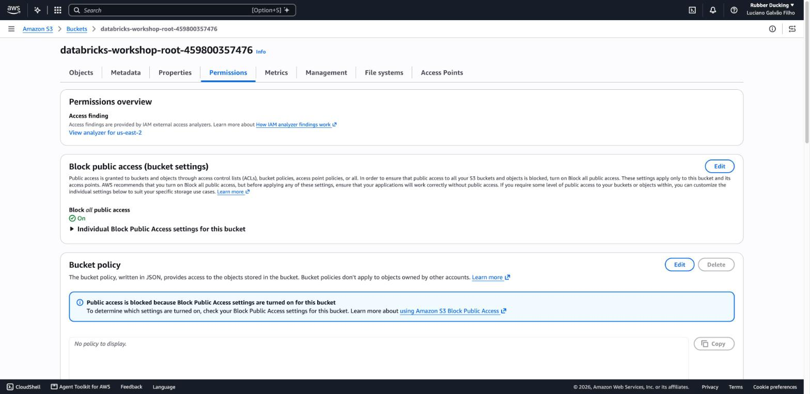

Cole o JSON com seus valores no lugar de `<NOME_DO_BUCKET>` e `<DATABRICKS_ACCOUNT_ID>`:

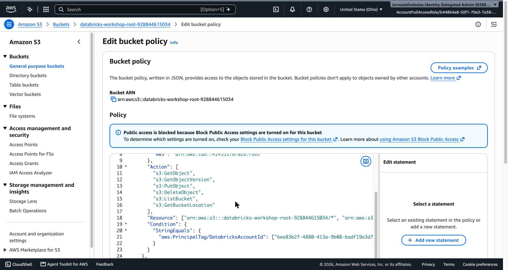

Confira se a validação mostra **Errors: 0** e clique em **Save changes**:

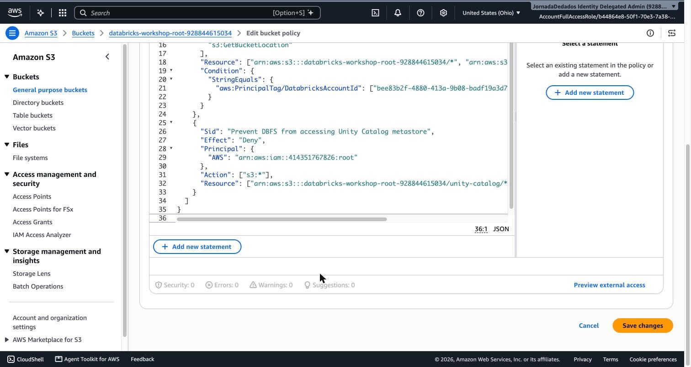

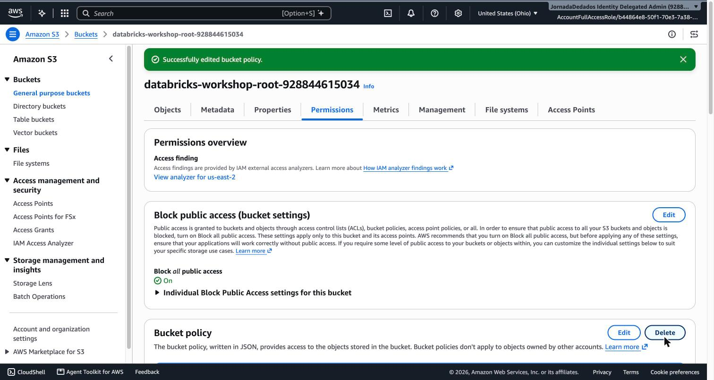

> O aviso azul "Public access is blocked" é esperado. A policy dá acesso a uma conta específica, e isso **não** é acesso público.

> **Confira se salvou mesmo:** depois de salvar, na seção **Bucket policy** o botão **Delete** tem que estar **ativo** e o JSON tem que aparecer. Se o botão estiver cinza, a policy não foi gravada (aconteceu no ensaio) e a criação do workspace falha lá no passo 6 com `ListAccess Denied`. Sempre cole o JSON com **Cmd+V / Ctrl+V** dentro do editor.

---

## 4. AWS · IAM role de storage (Unity Catalog)

**O que é:** uma *IAM role* é uma identidade sem senha que alguém de confiança pode "vestir" (assumir) por alguns minutos para fazer algo na sua conta. Esta role é a identidade que o **Unity Catalog** usa para ler e gravar os dados do catálogo do workspace no seu bucket (prefixo `unity-catalog/`).

Toda role tem duas partes:

| Parte | Pergunta que responde | Nesta role |
|---|---|---|
| **Trust policy** | **Quem** pode assumir a role? | A role mestre do Unity Catalog da Databricks (`UCMasterRole`) e a **própria role** (self-assuming), sempre com o External ID |
| **Permissions policy** | **O que** a role pode fazer? | Ler e gravar em `s3://<bucket>/unity-catalog/*` |

**Por que em duas etapas?** A trust policy final cita a própria role ("self-assuming"), e a AWS não deixa citar uma role que ainda não existe. Então criamos a role com uma trust provisória (External ID `0000`) e logo depois trocamos pela definitiva.

### 4.1 Criar a role com a trust provisória

**Onde:** IAM → **Roles** → **Create role** → **Custom trust policy**. Cole [`policies/04-storage-role-trust-etapa1.json`](policies/04-storage-role-trust-etapa1.json) (não precisa trocar nada).

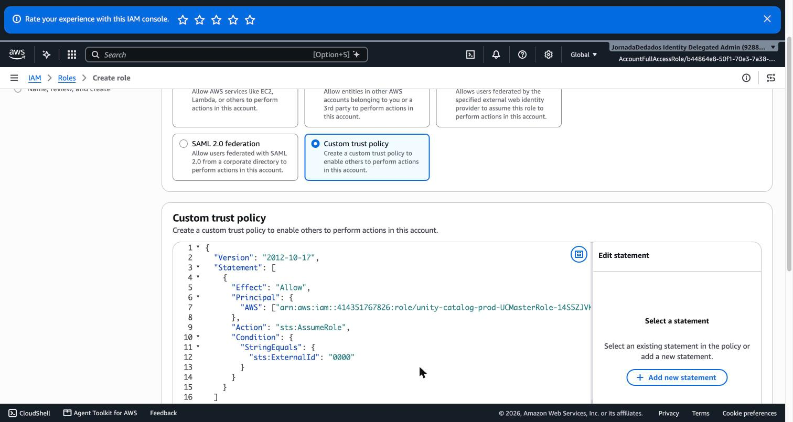

> **Custom trust policy ou AWS account?** As duas opções geram o mesmo tipo de JSON (a trust policy). *AWS account* é um formulário que só sabe dizer "a conta X inteira pode assumir". Aqui precisamos confiar numa **role específica** da Databricks e na própria role, e isso só dá para escrever no JSON (*Custom*).

### 4.2 Permissões: acesso ao S3

Em **Add permissions**, escolha **Create inline policy** e cole [`policies/06-storage-role-s3-policy.json`](policies/06-storage-role-s3-policy.json), trocando `<NOME_DO_BUCKET>`, `<AWS_ACCOUNT_ID>` e `<NOME_DA_STORAGE_ROLE>`.

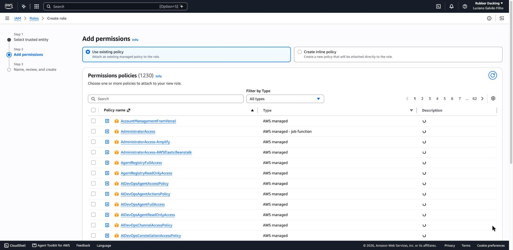

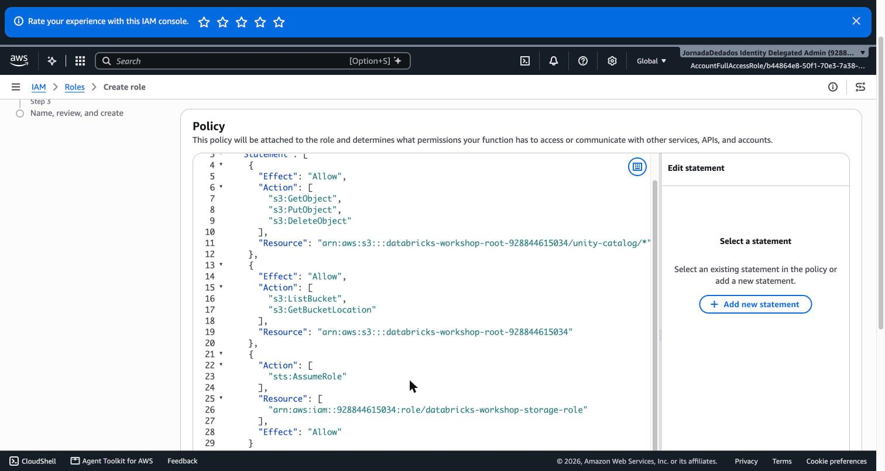

A policy dá três coisas: ler, gravar e apagar arquivos **só** em `unity-catalog/*`; listar o bucket; e assumir a si mesma (`sts:AssumeRole` na própria role, parte do self-assuming).

### 4.3 Nome e criação

- **Role name:** `databricks-workshop-storage-role` (ou o nome que você anotou).
- **Inline policy name:** `databricks-uc-s3-access`.

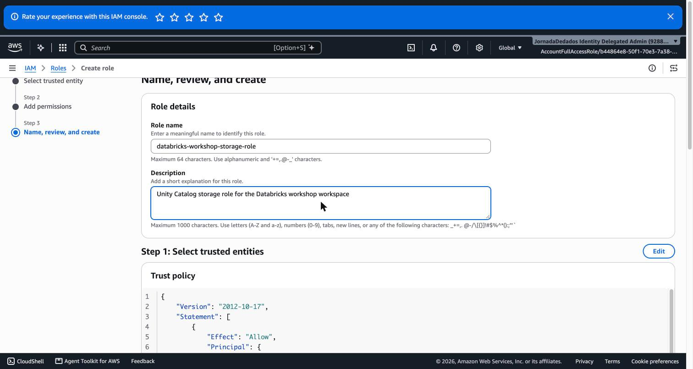

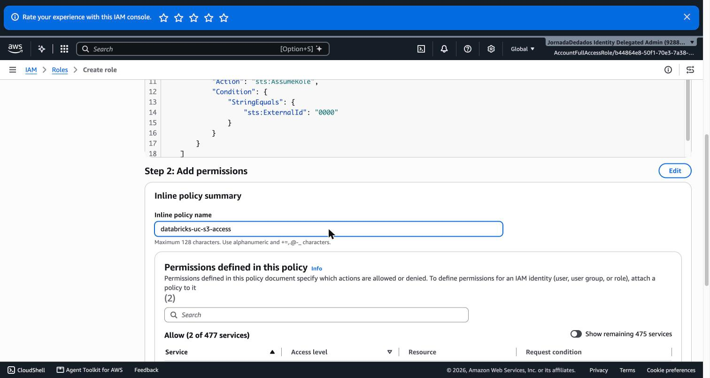

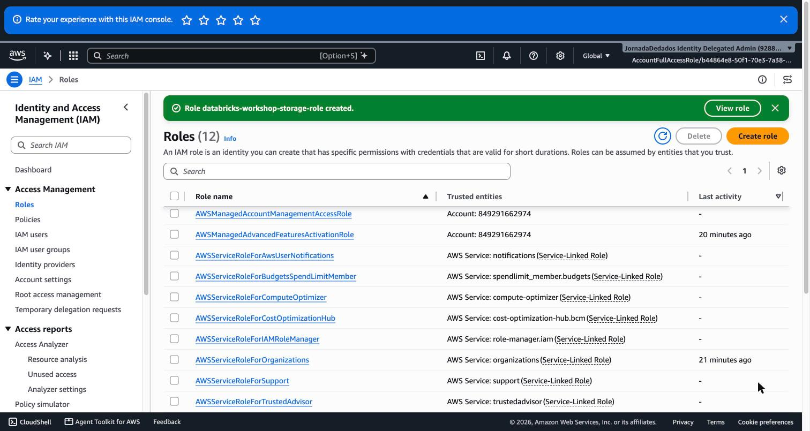

### 4.4 Trocar a trust pela versão self-assuming

Abra a role → aba **Trust relationships** → **Edit trust policy**. Cole [`policies/05-storage-role-trust-etapa2.json`](policies/05-storage-role-trust-etapa2.json) com seus valores. A mudança: o External ID passa de `0000` para o seu **Databricks Account ID**, e a própria role entra como principal.

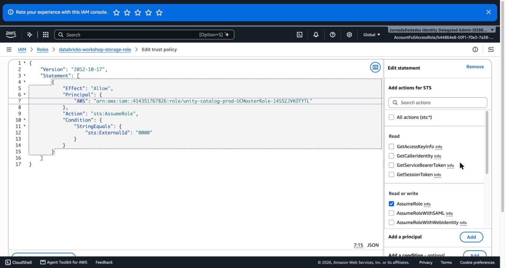

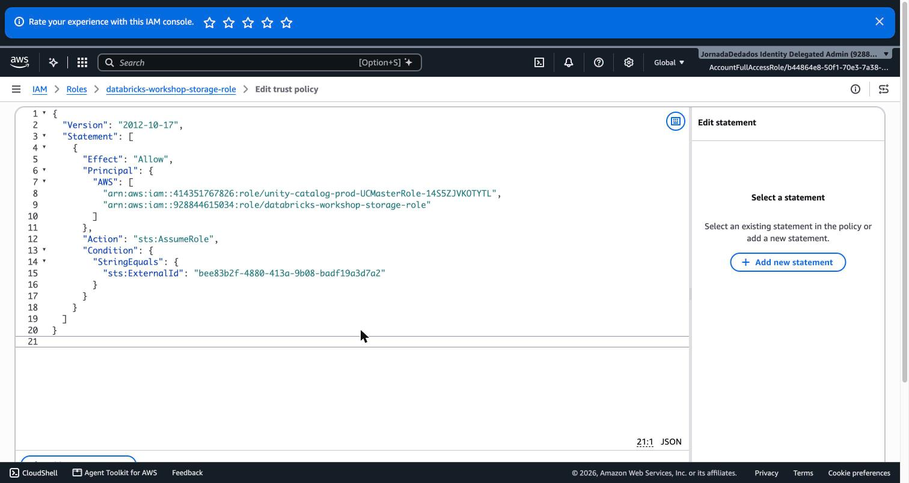

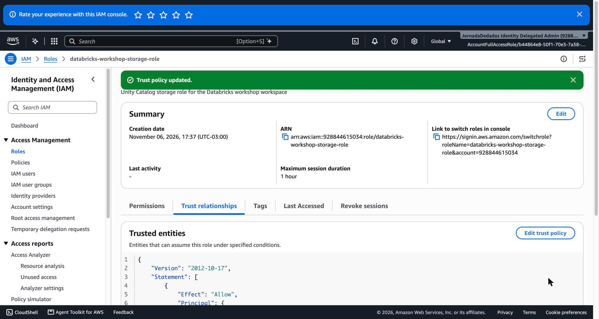

### 4.5 (Opcional) Policy de file events

[`policies/07-storage-role-file-events-policy.json`](policies/07-storage-role-file-events-policy.json) **não cria nada**. Ela só autoriza a Databricks a criar, quando for preciso, filas SQS e tópicos SNS para o recurso *file events* (o Auto Loader detectar arquivos novos no S3 sem ficar listando o bucket). É recomendada pela documentação, mas **pode ser pulada** no workshop.

**Onde:** aba **Permissions** → **Add permissions** → **Create inline policy** → **JSON**. Nome: `databricks-uc-file-events`.

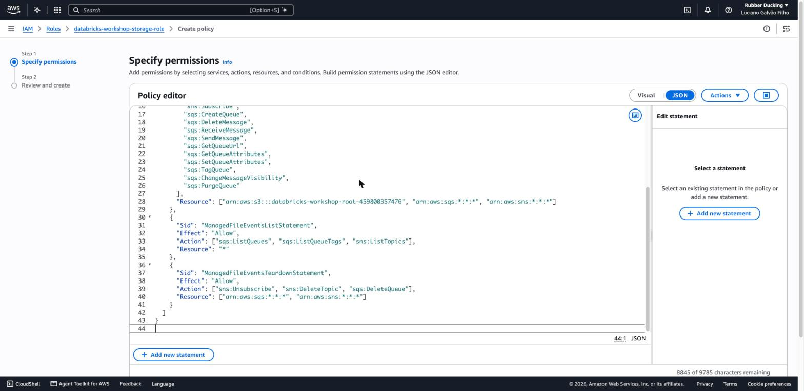

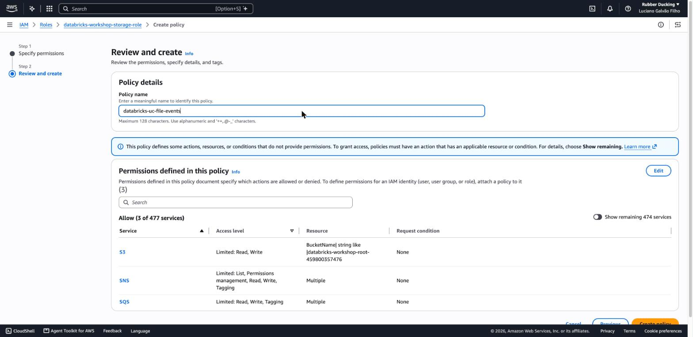

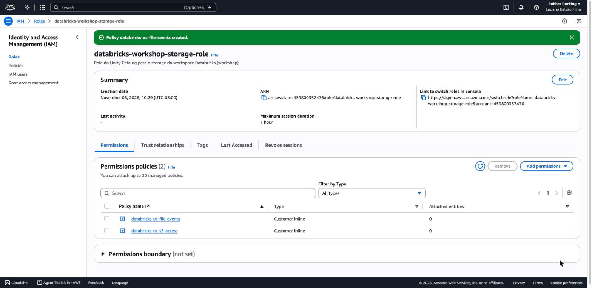

**Copie o ARN da role** (no topo da página, em *Summary*). Você vai colar no Databricks: `arn:aws:iam::<AWS_ACCOUNT_ID>:role/databricks-workshop-storage-role`.

---

## 5. AWS · IAM role cross-account (compute)

**O que é:** a role que a **Databricks assume para operar o compute na sua conta**: criar a rede (VPC, subnets, NAT), ligar e desligar as máquinas EC2 dos clusters. Sem ela, o workspace clássico não consegue ligar nenhum cluster.

| Parte | Nesta role |
|---|---|
| **Trust policy** | A conta AWS da Databricks (`414351767826`) pode assumir, **desde que** informe o External ID = seu Databricks Account ID |
| **Permissions policy** | Cerca de 75 ações de EC2 (rede, instâncias, volumes, spot) + criar a *service-linked role* de Spot |

**Por que o External ID?** A conta `414351767826` é a mesma para **todos** os clientes da Databricks. Sem o External ID, outro cliente poderia, em tese, pedir à Databricks para usar a **sua** role (o ataque do *confused deputy*, que a própria tela da AWS cita). Com ele, a Databricks só assume a sua role quando está agindo pela **sua** conta Databricks.

### 5.1 Trusted entity

**Onde:** IAM → **Roles** → **Create role** → **AWS account** → **Another AWS account**.

- **Account ID:** `414351767826` (conta AWS da Databricks).
- Marque **Require external ID** e cole o seu **Databricks Account ID**.

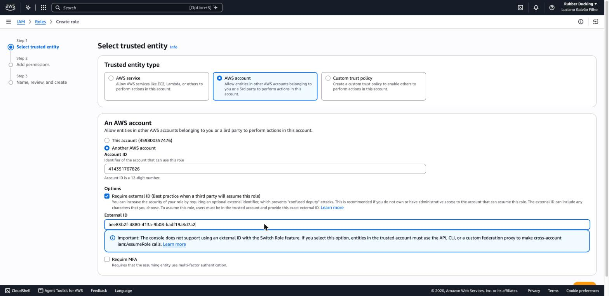

> Aqui o formulário *AWS account* basta, porque confiamos na conta da Databricks inteira. Se preferir, use *Custom trust policy* com [`policies/01-cross-account-trust-policy.json`](policies/01-cross-account-trust-policy.json): o resultado é idêntico. No segundo ensaio usamos o *Custom trust policy*:

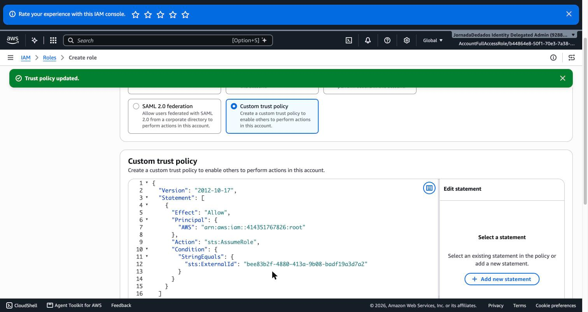

### 5.2 Permissões

**Create inline policy** → cole [`policies/02-cross-account-access-policy.json`](policies/02-cross-account-access-policy.json) (não tem nada para trocar). Esta é a versão para **Databricks-managed VPC**.

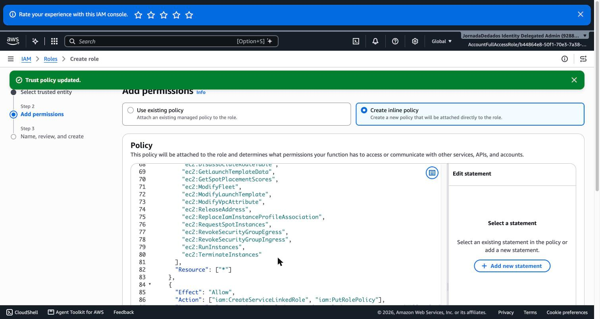

### 5.3 Nome e criação

- **Role name:** `databricks-workshop-cross-account-role`
- **Inline policy name:** `databricks-cross-account-ec2`

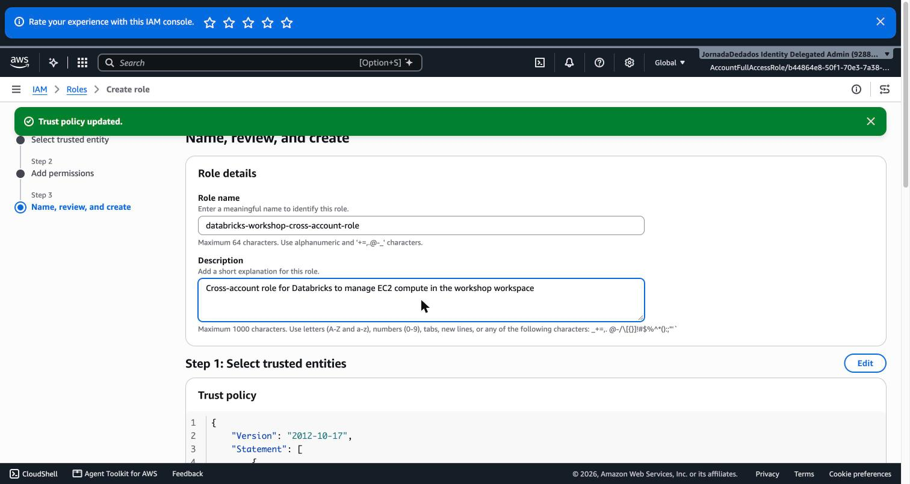

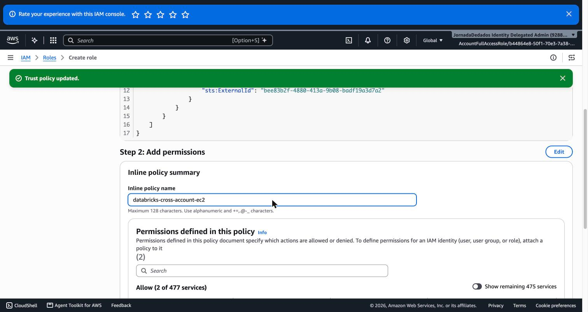


**Copie o ARN:** `arn:aws:iam::<AWS_ACCOUNT_ID>:role/databricks-workshop-cross-account-role`.

---

## Checkpoint · o que existe na AWS agora

| Recurso | Nome no ensaio | Obrigatório |
|---|---|---|
| Bucket S3 + bucket policy | `databricks-workshop-root-928844615034` | Sim |
| Storage role (UC) + policy S3 | `databricks-workshop-storage-role` | Sim |
| Policy file events | `databricks-uc-file-events` | Não |
| Cross-account role + policy EC2 | `databricks-workshop-cross-account-role` | Sim |

Nada disso tem custo parado. VPC, NAT Gateway e EC2 só surgem quando a Databricks cria o workspace e liga clusters.

---

## 6. Databricks · Registrar as peças e criar o workspace

Agora voltamos à tela do passo 1 e preenchemos cada bloco com o que criamos na AWS.

**Onde:** Account Console (<https://accounts.cloud.databricks.com>) → **Workspaces** → **Create workspace** → **Use your existing cloud account**.

### 6.1 Basics

- **Workspace name:** `workshop-aws` (vira parte da URL).
- **Region:** **Ohio (`us-east-2`)**, a mesma do bucket.
- **Storage and compute:** *Use your existing cloud account* → **Continue**.

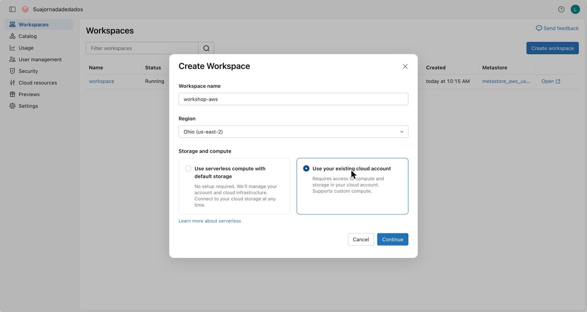

> **Dica:** você pode cadastrar credencial e storage antes, em **Cloud resources** (**Credential configuration** e **Storage configuration**), e só escolher no formulário. Foi assim no segundo ensaio.

### 6.2 Compute credentials (cross-account role)

No campo **Compute credentials**, abra o dropdown → **Add cloud credentials** → **Add manually**.

- **External ID:** já vem preenchido com o seu Databricks Account ID. Confira se é o mesmo que você colou na trust policy do passo 5.1.
- **Cloud credential name:** `workshop-cross-account-credential`.
- **Role ARN:** o ARN da cross-account role (passo 5.3): `arn:aws:iam::<AWS_ACCOUNT_ID>:role/databricks-workshop-cross-account-role`.

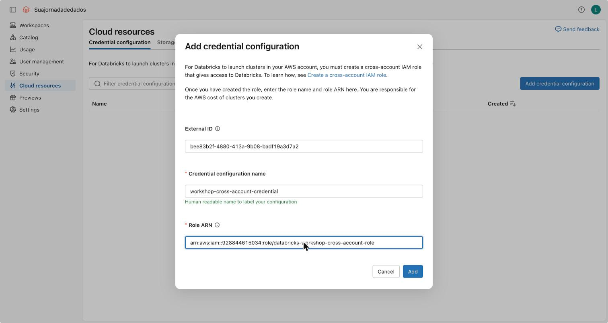

Clique em **OK**. Nesse momento a Databricks **assume a role e testa as permissões de EC2**. Se der erro, veja o [Troubleshooting](#troubleshooting).

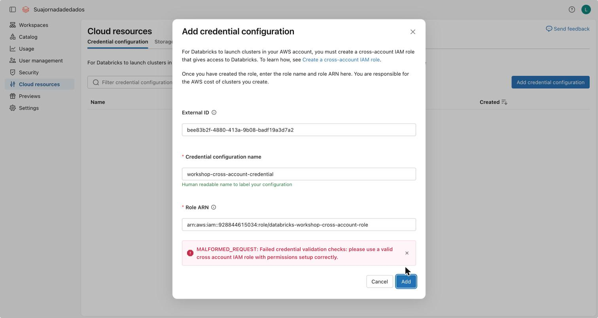

> No ensaio, a validação falhou com `MALFORMED_REQUEST: Failed credential validation checks`. A causa não estava nas policies, e sim nas **travas da AWS Organization** (uma SCP de região e uma RCP que bloqueia contas externas). O diagnóstico e a correção estão no [Troubleshooting](#troubleshooting). Depois de corrigir:

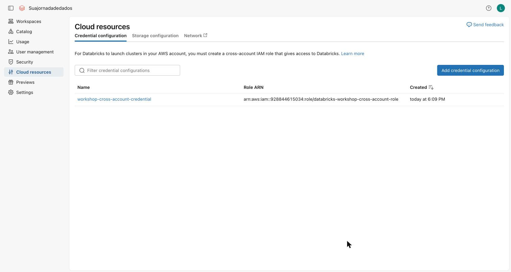

**Network configuration:** deixe **Databricks-managed VPC**. A Databricks cria a VPC, as subnets e o NAT Gateway na sua conta usando a cross-account role.

### 6.3 Workspace storage (bucket + storage role)

No campo **Workspace storage**, abra o dropdown → opção de adicionar storage → **Add manually** (a mesma tela do print do passo 1.3):

- **Storage configuration name:** `workshop-storage`.
- **Bucket name:** `<NOME_DO_BUCKET>` (passo 2), só o nome, sem `s3://`.
- **IAM role:** o ARN da storage role (passo 4.5): `arn:aws:iam::<AWS_ACCOUNT_ID>:role/databricks-workshop-storage-role`.

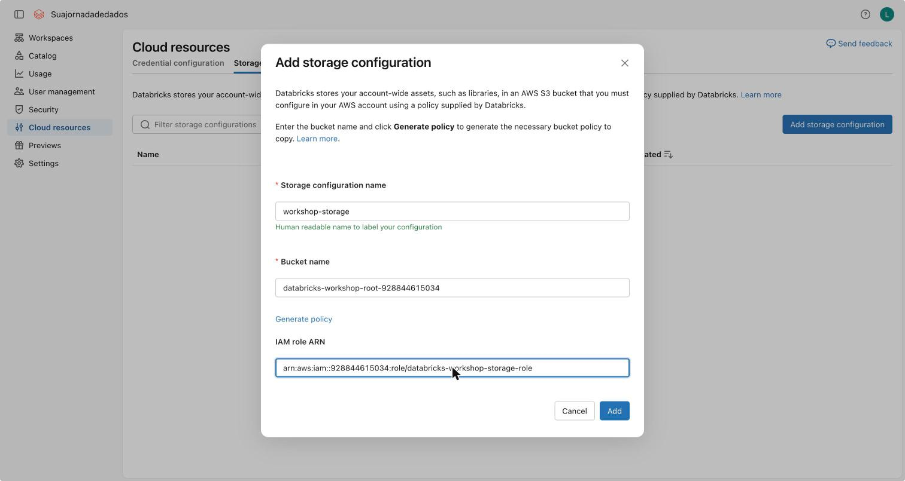

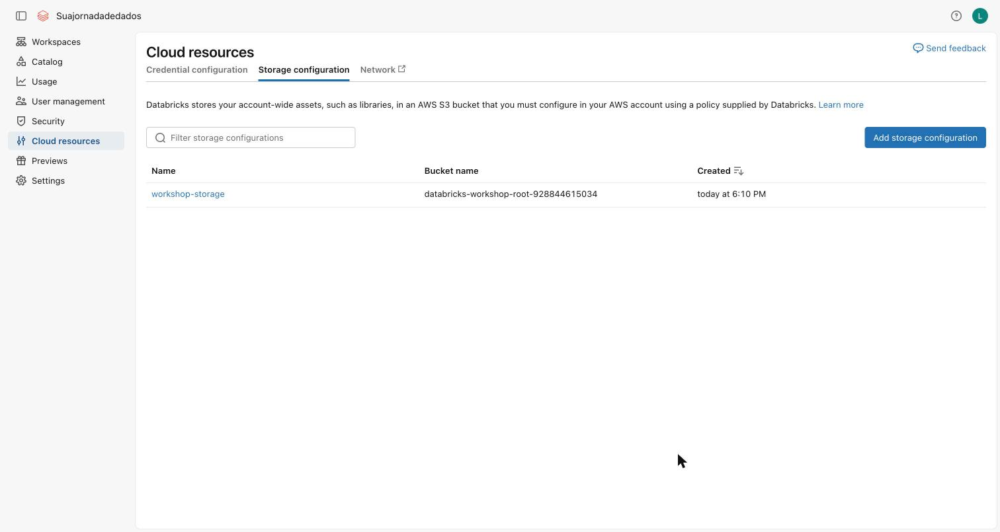

**Metastore:** já aparece `metastore_aws_us_east_2`. Não precisa mexer.

### 6.4 Networking e criação

- **Private access setting:** *None* (sem PrivateLink).
- Clique em **Create workspace**.

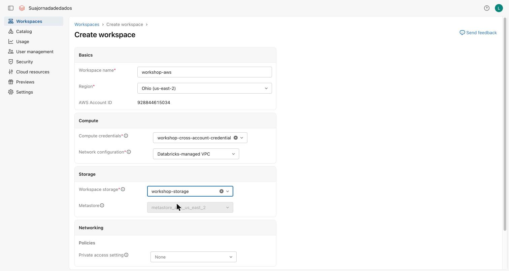

> Só aqui a Databricks testa o **bucket** (List, Put, Delete). Se a bucket policy não estiver gravada, o erro aparece agora: `Failed storage configuration validation checks ... ListAccess Denied`. Veja o [Troubleshooting](#troubleshooting).

O status fica em **Provisioning** por alguns minutos (a Databricks está criando a rede na sua AWS) e depois muda para **Running**. Clique na URL do workspace (`https://dbc-xxxx.cloud.databricks.com`) para abrir.

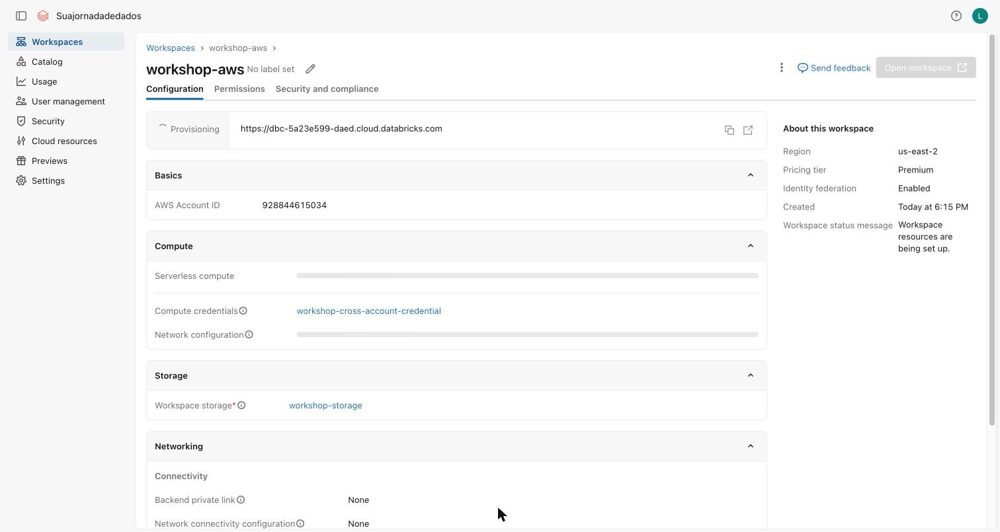

No ensaio, levou cerca de 2 minutos para ficar **Running**:

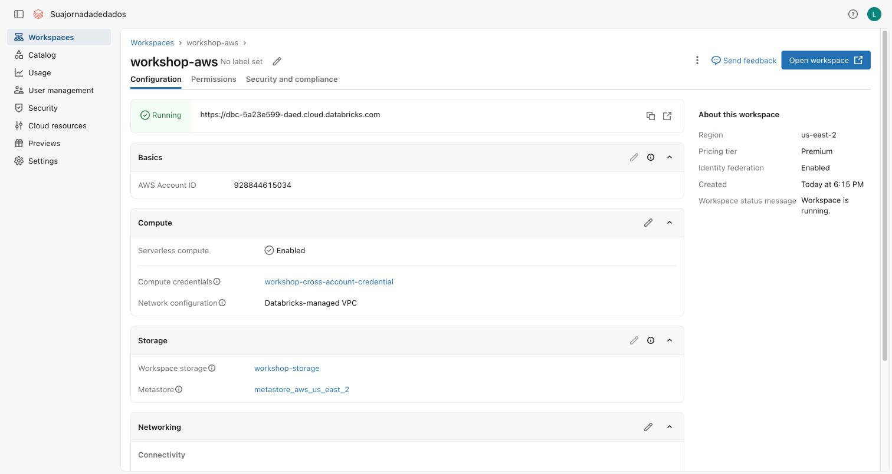

> **A partir daqui o relógio de custo começa a rodar:** o NAT Gateway cobra por hora mesmo sem cluster ligado. Veja [Quanto custa](#quanto-custa) e a [Limpeza](#8-limpeza).

---

## Quanto custa

Valores de referência da AWS em `us-east-2` (Ohio), sem impostos. Confira a página de preços da AWS antes do workshop, porque os valores mudam.

| Item | Quando cobra | Preço | Por mês (730 h) |
|---|---|---|---|
| VPC, subnets, route tables, security group, Internet Gateway | Sempre | Grátis | US$ 0 |
| **NAT Gateway** (1, criado pela Databricks-managed VPC) | Enquanto o workspace existir, **mesmo sem cluster** | US$ 0,045/hora + US$ 0,045 por GB processado | **~US$ 33** + tráfego |
| **IPv4 público / Elastic IP** do NAT | Enquanto existir | US$ 0,005/hora | ~US$ 3,65 |
| **Total da rede parada** | | | **~US$ 37/mês** (~US$ 1,20/dia) |
| Instâncias EC2 (driver e workers) | Só com cluster ligado | Depende do tipo (ex.: `m5.large` ~US$ 0,10/hora cada) | Proporcional ao uso |
| DBUs (fatura Databricks) | Só com compute ligado | Depende do tier e do tipo de compute | Proporcional ao uso |
| Bucket S3 | Pelo que for gravado | ~US$ 0,023 por GB/mês | Centavos |
| IAM roles, credential e storage configuration | Nunca | Grátis | US$ 0 |

**Resumo para falar em aula:** um workspace clássico parado custa **~US$ 1,20 por dia** só de rede (NAT + IP). Por isso a conta AWS precisa estar no **plano pago** e por isso a [Limpeza](#8-limpeza) é no mesmo dia. Em produção, com muitos clusters, o tráfego pelo NAT (US$ 0,045/GB) costuma pesar mais que a hora do NAT. VPC endpoints para S3 e STS reduzem esse custo.

---

<!-- CONTINUA: 7. configuração profissional -->

---

## 8. Limpeza

Faça no mesmo dia do workshop, **nesta ordem** (o workspace usa as roles, então ele sai primeiro):

1. **Clusters:** no workspace, **Compute** → encerre (*Terminate*) todos os clusters.
2. **Workspace:** Account Console → **Workspaces** → seu workspace → **Delete**. Aguarde sumir da lista.
3. **Configurações:** Account Console → **Cloud resources** → apague a **credential** e a **storage configuration** do workshop.
4. **Conferir a rede na AWS** (região `us-east-2`): **VPC** → NAT Gateways, Elastic IPs e VPCs com `databricks` no nome; **EC2** → Instances. Se algo sobrou, apague (NAT Gateway primeiro, depois liberar o Elastic IP, depois a VPC).
5. **IAM:** apague as roles `databricks-workshop-cross-account-role` e `databricks-workshop-storage-role`.
6. **S3:** esvazie o bucket (**Empty**) e depois apague (**Delete**).

> Fez pelo Terraform? Basta `terraform destroy` (veja o [README do Terraform](../terraform/README.md)) e depois conferir o item 4.

---

## Troubleshooting

| Sintoma | Causa provável | Como resolver |
|---|---|---|
| `MALFORMED_REQUEST: Failed credential validation checks` ao salvar a credencial, com as policies corretas | A conta AWS está numa **AWS Organization** (por exemplo, criada pela tela **"Projects"**) com travas que bloqueiam a Databricks: uma **SCP** de região e/ou uma **RCP** que bloqueia contas externas. | Veja a seção [Conta AWS dentro de uma Organization](#conta-aws-dentro-de-uma-organization-scp-e-rcp) abaixo. Alternativa: usar uma conta AWS tradicional, fora de Organization, no plano pago. |
| `Failed storage configuration validation checks: List,Put,PutWithBucketOwnerFullControl,Delete ... ListAccess Denied` ao clicar em **Create workspace** | A **bucket policy não foi gravada** (o console mostrou "Successfully edited", mas o JSON não entrou), ou uma RCP bloqueia `s3:*` para contas externas. | No CloudShell: `aws s3api get-bucket-policy --bucket <NOME_DO_BUCKET>`. Se der `NoSuchBucketPolicy`, refaça o passo 3 colando com Cmd+V. Se a policy existir, confira a RCP (seção abaixo). |
| Mesmo erro, em conta AWS tradicional | External ID diferente do Databricks Account ID, ARN digitado errado, policy EC2 não salva na role, ou o IAM ainda não propagou | Confira a trust policy (passo 5.1), a aba **Permissions** da role (passo 5.2) e o ARN. Espere 1 minuto e tente de novo. |
| Erro ao salvar a storage configuration | Nome do bucket com `s3://`, bucket em outra região, bucket policy com Account ID errado, ou trust da storage role ainda na versão provisória (`0000`) | Revise os passos 2, 3 e 4.4. |
| Workspace fica em **Failed** | Falta de permissão EC2 na cross-account role, ou limite de VPC / Elastic IP da conta AWS atingido na região | Veja a mensagem no Account Console; confira a policy do passo 5.2 e os limites (*Service Quotas*) de VPC e Elastic IP em `us-east-2`. |
| A política do bucket não salva (*Errors* > 0) | Algum `< >` ficou sem trocar no JSON | Troque `<NOME_DO_BUCKET>` e `<DATABRICKS_ACCOUNT_ID>` e valide de novo. |

### Conta AWS dentro de uma Organization (SCP e RCP)

Foi o que travou o segundo ensaio, numa conta criada pela tela **"Projects"** da AWS (que ativa os *advanced features* do AWS Organizations). A organização cria duas travas que valem acima de qualquer permissão de IAM:

| Trava | Nome no ensaio | O que bloqueia | Efeito na Databricks |
|---|---|---|---|
| **SCP** (Service Control Policy) | `AdvancedModeRegionRestrictionSecurityControlPolicy` | EC2 e quase tudo fora de **uma região** (no ensaio, só Ohio) | A validação da cross-account role faz chamadas EC2 em outras regiões e é negada |
| **RCP** (Resource Control Policy) | `ManagedAccountResourceControlPolicy` | `sts:*`, `s3:*` e outros para **qualquer conta de fora da organização** | A Databricks (conta `414351767826`) **não consegue nem assumir** a cross-account role, nem usar o bucket |

**1. Diagnóstico (2 minutos, no CloudShell da conta do workshop):**

```bash
# EC2 em outras regiões: se aparecer "explicit deny in a service control policy", é a SCP
for r in us-east-1 us-west-2; do
  aws ec2 create-vpc --dry-run --cidr-block 10.99.0.0/16 --region $r 2>&1 | tail -1
done

# A Databricks chegou a assumir a role? Nenhuma linha = está sendo barrada antes (RCP)
aws cloudtrail lookup-events --region us-west-2 \
  --lookup-attributes AttributeKey=EventName,AttributeValue=AssumeRole --max-results 50 \
  --query 'Events[].CloudTrailEvent' --output text | grep -o 'databricks-workshop-cross-account-role' | head -1
```

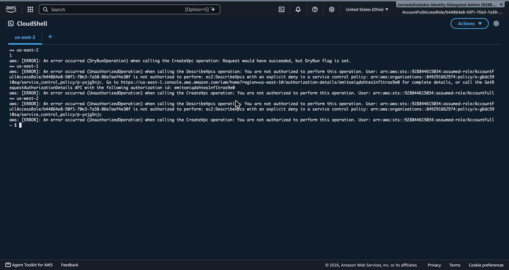

**2. Correção (feita na conta de gerenciamento da organização, a *Management Account*):**

- **SCP:** em **AWS Organizations → Policies → Service control policies →** a policy de região **→ Targets**. Ela estava na **Root**. Para não soltar a trava das outras contas: **Attach** nas outras contas e depois **Detach** da Root. Para o workshop, só o Detach da Root resolve (mas solta todas as contas). Atenção: a SCP tem limite de 5.120 caracteres e essa já usa quase tudo, então não dá para adicionar exceção no JSON.
- **RCP:** em **Policies → Resource control policies → `ManagedAccountResourceControlPolicy` → Edit policy**. Na primeira regra (`DenyAnyoneOutsideMyOrgAndAWS`), dentro do `"Condition"`, acrescente a exceção para a conta da Databricks:

```json
"StringNotEquals": {
  "aws:PrincipalAccount": "414351767826"
}
```

A regra continua bloqueando qualquer outra conta externa. Só a Databricks passa, e ela continua limitada pelas trust policies com External ID.

**3. Teste:** volte em **Cloud resources → Credential configuration → Add** e tente de novo. Se der o mesmo erro, feche o modal e abra de novo, porque ele guarda o estado da tentativa anterior.

> **Lição para a aula:** `MALFORMED_REQUEST: Failed credential validation checks` é uma mensagem genérica. Antes de mexer nas policies da role, confira se a conta não está numa Organization com SCP ou RCP. O CloudTrail mostra quem foi barrado e onde.

### Dicas do console AWS

- **Sempre cole o JSON com Cmd+V / Ctrl+V dentro do editor.** O editor do console às vezes mostra o texto mas não o registra (por exemplo, quando ele entra por extensão ou autopreenchimento). O sinal é o botão **Next** não avançar, ou a policy "salva" não aparecer depois.
- A KB da Databricks [*Failed credential validation checks error with Terraform*](https://kb.databricks.com/terraform/failed-credential-validation-checks-error-with-terraform) trata de outro caso: a role recém-criada ainda não propagou. Esperar 1 minuto e tentar de novo resolve. O nosso Terraform já tem um `time_sleep` para isso.
