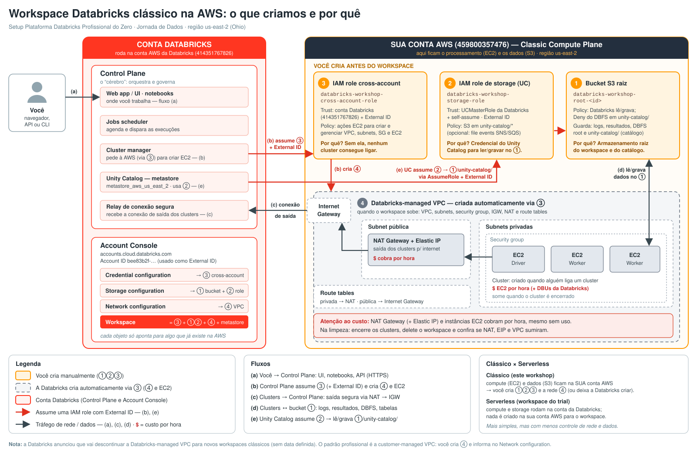

# Arquitetura: workspace Databricks clássico na AWS

> Versão PNG para slides: `arquitetura-aws-databricks.png` (1600 px de largura).

Numeração usada no desenho: **①** bucket S3 raiz, **②** IAM role de storage (Unity Catalog), **③** IAM role cross-account, **④** rede (VPC) criada pela Databricks. Os fluxos são **(a)** a **(e)**.

## Por que tudo isso?

### Control plane x compute plane

A Databricks é dividida em dois "andares":

- **Control Plane** (na conta AWS da própria Databricks, `414351767826`): é o "cérebro". Hospeda a interface web, os notebooks, o agendador de jobs, o cluster manager e o **metastore do Unity Catalog** da região (`metastore_aws_us_east_2`). Ele **decide e orquestra**, mas não executa o seu processamento num workspace clássico.
- **Classic Compute Plane** (na **sua** conta AWS, `459800357476`): é onde o trabalho pesado acontece. As máquinas EC2 dos clusters (driver e workers) rodam aqui, e os dados ficam no **seu** bucket S3.

É exatamente essa separação que faz uma empresa escolher o workspace clássico: os dados e o processamento ficam dentro da conta AWS da empresa, com a rede, a criptografia e o custo de infraestrutura sob o controle dela.

### Por que a Databricks precisa de acesso à sua conta?

O Control Plane precisa **agir** dentro da sua conta: ligar e desligar EC2 quando alguém inicia um cluster (fluxo **b**), criar a rede ④ e ler/gravar dados no bucket ① (fluxo **e**). Em vez de entregar chaves de acesso (access key/secret), damos à Databricks **IAM roles** que ela pode **assumir** (`sts:AssumeRole`):

- **③ cross-account role**: a "chave do compute". Permite ações EC2 (VPC, subnets, security group, instâncias). Sem ela, nenhum cluster liga.
- **② storage role**: a "chave dos dados" do Unity Catalog. Só dá acesso ao prefixo `unity-catalog/` do bucket.

Cada role tem duas partes: a **trust policy** (quem pode assumir: a conta da Databricks, ou a `unity-catalog-prod-UCMasterRole`) e a **permission policy** (o que pode fazer depois de assumir). A storage role também confia em si mesma (*self-assuming*), um requisito atual do Unity Catalog.

### O que é External ID e por que ele existe (o problema do "confused deputy")

A conta AWS da Databricks atende **milhares de clientes**. Imagine que a trust policy da sua role dissesse apenas "a conta 414351767826 pode me assumir". Um atacante, também cliente da Databricks, poderia cadastrar no Account Console **o ARN da sua role** como se fosse dele. A Databricks (o "deputado") usaria as próprias permissões legítimas para assumir a sua role em nome do atacante: ele "confundiu" o deputado.

O **External ID** fecha essa brecha. A trust policy exige `sts:ExternalId = <Account ID da Databricks do cliente>` (no nosso caso, `bee83b2f-…`). Quando a Databricks assume a role, ela envia o Account ID **de quem pediu**. Se o atacante cadastrar a sua role, a Databricks enviará o Account ID dele, que não bate com o da condição, e a AWS nega o acesso.

Resumo para falar em aula: **"a conta da Databricks é compartilhada; o External ID garante que só a SUA conta Databricks usa a SUA role"**.

### Como as peças viram objetos no Account Console

| Objeto no Account Console | Aponta para |
|---|---|
| Credential configuration | ③ cross-account role (ARN) |
| Storage configuration | ① bucket S3 raiz + ② storage role |
| Network configuration | ④ VPC: Databricks-managed (padrão) ou customer-managed |
| Workspace | junta credential + storage + network + metastore da região |

Esses objetos só **referenciam** recursos que já existem na AWS. Por isso a ordem é: criar na AWS primeiro, registrar no Account Console depois.

## Antes do workspace: conta, cobrança, região e plano

### Os três "lugares" de um workspace

| Peça | Onde roda | Workspace clássico | Workspace serverless |
|---|---|---|---|
| Control plane (web app, APIs, cluster manager, jobs, Unity Catalog) | Conta AWS da Databricks | ✔ | ✔ |
| Serverless compute plane (SQL, jobs e notebooks serverless) | Conta AWS da Databricks | Opcional | ✔ (é o único compute) |
| Classic compute plane (EC2 na sua VPC) + seus buckets S3 | **Sua** conta AWS | ✔ | — |

O control plane **sempre** fica na conta da Databricks, na região do workspace. O que muda entre os tipos de workspace é **onde roda o compute**. A ponte para a sua conta é a cross-account role ③ (compute) e as credenciais do Unity Catalog ② (dados).

### Quatro formas de começar (e quem te cobra)

| Caminho | Para quem | Como funciona |
|---|---|---|
| **Express setup** | Começar rápido | Cadastro só com e-mail, sem conta AWS. Cria um workspace **serverless** com créditos de trial válidos por **14 dias**. Vira pago com cartão ou contrato. |
| **AWS Marketplace** | Empresa que já compra pela AWS | Pay-as-you-go. A Databricks vira **uma linha na fatura da AWS** e o gasto pode abater compromissos do **EDP** (Enterprise Discount Program) da AWS. |
| **Contrato direto** | Grandes ambientes | Compromisso de consumo negociado com a Databricks, faturado direto por ela, com **desconto no preço do DBU**. |
| **Free Edition** | Estudo e hobby | Gratuita, só serverless, com limites de capacidade. **Não serve para produção.** |

> O medidor é o mesmo em todos: o **DBU**. Muda só quem emite a fatura. E o custo de EC2, S3 e NAT do workspace clássico sempre vem na **sua fatura AWS**, à parte.

### Região é decisão de funcionalidade

A Databricks na AWS está na maioria das regiões comerciais (Américas, Europa, Ásia-Pacífico) e na **AWS GovCloud** (`us-gov-west-1`, com os ambientes GovCloud e GovCloud DoD). Os recursos disponíveis **variam por região**: confira a disponibilidade antes de escolher, não só a latência. No workshop usamos `us-east-2` (Ohio).

### Planos (tiers)

| | **Premium** (padrão) | **Enterprise** |
|---|---|---|
| Para quem | Toda conta nova começa aqui | Ambientes regulados e fechados |
| Inclui | Unity Catalog, RBAC, audit logs, compute serverless, Databricks SQL | Tudo do Premium + **AWS PrivateLink**, **chaves gerenciadas pelo cliente (CMK)**, **compliance security profile**, **enhanced security monitoring** |

O **Standard acabou**: os workspaces Standard restantes foram migrados automaticamente para Premium em **1º de outubro de 2025**. O tier é um atributo **comercial da conta** (não do workspace), e os recursos de segurança do Enterprise costumam ser o motivo do upgrade.

### "E2": vocabulário aposentado

Por anos a arquitetura atual da Databricks na AWS se chamou **E2** (a "segunda geração": várias workspaces por conta, customer-managed VPC, secure cluster connectivity). O nome sumiu da documentação porque toda conta suportada já está nela: hoje é simplesmente "a plataforma". Se aparecer "E2" em blog antigo, conversa de corredor ou no prefixo dos recursos Terraform `databricks_mws_*` (*Multi-Workspace Services*), leia como "a plataforma atual".

## Recursos

| # | Recurso | Quem cria | Papel | Custo |
|---|---|---|---|---|
| ① | Bucket S3 raiz `databricks-workshop-root-<id>` + bucket policy | Você | Armazenamento raiz do workspace: logs, resultados de notebooks, DBFS root e, sob `unity-catalog/`, os dados do catálogo do workspace. A policy libera a conta Databricks e nega o DBFS em `unity-catalog/`. | Centavos (por GB armazenado + requisições) |
| ② | IAM role `databricks-workshop-storage-role` | Você | Credencial do Unity Catalog para ler/gravar em `unity-catalog/*`. Trust na `UCMasterRole` + self-assume + External ID. | Grátis |
| ③ | IAM role `databricks-workshop-cross-account-role` | Você | Permite à Databricks criar/gerenciar rede e instâncias EC2. Trust na conta `414351767826` + External ID. | Grátis |
| ④ | VPC, subnets, security group, route tables | Databricks (via ③), ao criar o workspace | Rede isolada onde os clusters rodam. | Grátis |
| ④ | Internet Gateway | Databricks (via ③) | Porta da VPC para a internet. | Grátis |
| ④ | NAT Gateway + Elastic IP | Databricks (via ③) | Saída das subnets privadas: clusters falam com o Control Plane (fluxo **c**) e baixam pacotes. | **Por hora** (+ por GB trafegado), mesmo sem cluster ligado |
| ④ | Instâncias EC2 (driver/workers) | Databricks (via ③), quando alguém liga um cluster | Executam o Spark. | **Por hora** (EC2 na fatura AWS) + DBUs na fatura Databricks |
| — | Credential, Storage e Network configuration, Workspace | Você, no Account Console | Registram ①②③④ e montam o workspace. | Grátis (só o uso gera custo) |
| — | Metastore `metastore_aws_us_east_2` | Já existe (Databricks) | Governança: tabelas, permissões, linhagem. Atribuído ao workspace. | Grátis |

> **Na limpeza do workshop:** encerre os clusters, delete o workspace no Account Console e depois confira no console AWS (região us-east-2) se **NAT Gateway, Elastic IP, instâncias EC2 e VPC** sumiram. O NAT Gateway é o item que mais "esquecem" e continua cobrando por hora.

## Obrigatório x opcional

**Obrigatório para um workspace clássico:**

- ① Bucket S3 raiz com a bucket policy.
- ② IAM role de storage (Unity Catalog) com trust + External ID e policy em `unity-catalog/*`.
- ③ IAM role cross-account com trust + External ID e a policy EC2.
- Uma rede ④ (Databricks-managed, criada automaticamente, ou customer-managed).
- No Account Console: credential configuration, storage configuration e o workspace (com o metastore da região atribuído).

**Opcional:**

- **File events** na policy da storage role: permite à Databricks criar SNS/SQS sob demanda para o Auto Loader detectar arquivos novos. Nada é criado agora.
- **Customer-managed VPC** (em vez da Databricks-managed): você cria ④ e informa no *Network configuration*. Dá controle total sobre CIDR, subnets, endpoints e regras de saída.
- PrivateLink, chaves de criptografia gerenciadas pelo cliente (CMK), logs de auditoria em bucket próprio: tópicos de hardening, fora do escopo deste setup. PrivateLink e CMK exigem o plano **Enterprise** (veja [Planos](#planos-tiers)).

## Clássico x Serverless

| | Serverless (workspace do trial) | Clássico (este workshop) |
|---|---|---|
| Onde roda o compute | Conta AWS da Databricks | Sua conta AWS (EC2) |
| Onde ficam os dados | Storage gerenciado pela Databricks | Seu bucket S3 |
| O que você cria na AWS | Nada | ①, ②, ③ (e opcionalmente ④) |
| Controle de rede e custo de infra | Baixo | Total |

## Nota sobre a Databricks-managed VPC

A Databricks anunciou que vai **descontinuar a Databricks-managed VPC para novos workspaces clássicos** (ainda sem data). No workshop usamos a opção gerenciada para focar no essencial; em produção, o padrão profissional é a **customer-managed VPC**.
